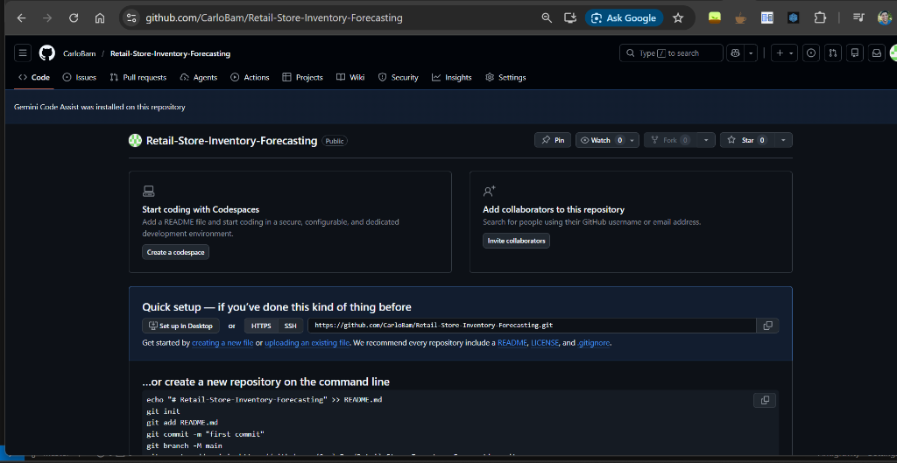

# Retail Price Elasticity & Demand Forecasting System

## Why I built this
I asked a data scientist I work with for a project that would stretch me beyond my day-to-day work. She gave me a shortlist, and I chose this one because retail demand and pricing are close to the business I know.

While exploring the data, I noticed it looked too uniform for real sales. Testing that suspicion confirmed it: price had no measurable effect on demand, the `Demand Forecast` column tracked actual sales almost perfectly, and the season labels did not line up with the dates. The dataset's Kaggle page confirms it is synthetic.

The main lesson for me: check where data comes from, and whether it can answer the question, before trusting any result. Next time I will start with real public data.

**Tech Stack**: Python, Streamlit, Statsmodels, Prophet, TensorFlow, Plotly/Matplotlib

---

## 1. Business Context
Retailers need to avoid stockouts and set prices that support revenue. I built this app to explore inventory needs and price elasticity with retail sales data.
1.  **Demand Forecasting**: Estimate future inventory needs for supply planning.
2.  **Pricing Intelligence**: Estimate price elasticity to inform discount decisions.

The Streamlit app lets users explore data, compare scenarios, and export recommendations.



## 2. Dataset Description
**Source:** [Retail Store Inventory Forecasting Dataset](https://www.kaggle.com/datasets/anirudhchauhan/retail-store-inventory-forecasting-dataset) by Anirudh Singh Chauhan on Kaggle (CC0: Public Domain). The dataset is synthetic.

The app reads retail transaction data.

| Column | Type | Description |
| :--- | :--- | :--- |
| `Date` | Datetime | Transaction date (daily freq). |
| `Store ID` | Categorical | Unique identifier for retail location. |
| `Product ID` | Categorical | Unique identifier for SKU. |
| `Category` | Categorical | Product hierarchy (e.g., Electronics, Clothing). |
| `Units Sold` | Integer | **Target Variable**. Quantity demanded/sold. |
| `Price` | Float | Unit price at time of sale. |
| `Discount` | Float | Discount percentage applied (0-100). |
| `Competitor Pricing`| Float | Price of equivalent SKU at primary competitor. |
| `Holiday` / `Promo` | Binary | Flags for external events affecting demand. |

## 3. Analytical Approach

### A. Exploratory Data Analysis (EDA)
I use exploratory analysis to examine:
*   **Seasonality**: Weekly and annual cycles using decomposition.
*   **Segmentation**: High-value vs. low-value regions and categories.
*   **Distributions**: identifying price clustering and outlier sales events.

### B. Forecasting Service
I built a single interface in `src.forecasting` for three model types:
1.  **ARIMA (SARIMAX)**: Baseline statistical model capturing autocorrelation and seasonality.
2.  **Prophet**: Additive regression model effective for handling holidays and changepoints.
3.  **LSTM (Deep Learning)**: Recurrent Neural Network for capturing complex non-linear temporal dependencies (requires sufficient data depth).

### C. Pricing & Elasticity Engine
I use a **Log-Log Regression Model** to estimate price elasticity ($\beta$).

$$ \log(\text{Units}) = \alpha + \beta \cdot \log(\text{Effective Price}) + \gamma \cdot \text{Controls} + \epsilon $$

*   **Controls**: I control for `Seasonality`, `Promotion Presence`, and `Competitor Gaps` to isolate the price effect.
*   **Controls**: I control for `Seasonality`, `Promotion Presence`, and `Competitor Gaps` to isolate the price effect.
*   **Standard Errors**: I use HC1 standard errors to account for heteroscedasticity in sales data.

## 4. Key Results & Interpretation

### Price elasticity is effectively zero in this dataset

Log-log regression per category, with controls for promotion, season, region and competitor price gap, using HC1 robust standard errors (72,740 rows with positive sales):

| Category | Elasticity (β) | p-value | R² |
| :--- | :---: | :---: | :---: |
| Clothing | −0.003 | 0.83 | 0.001 |
| Electronics | −0.009 | 0.57 | 0.001 |
| Furniture | −0.006 | 0.70 | 0.000 |
| Groceries | +0.015 | 0.35 | 0.001 |
| Toys | −0.000 | 0.98 | 0.000 |

**Interpretation:** No category shows a statistically significant price response, and price explains almost none of the variation in units sold. Real retail data almost always shows negative elasticities. The most likely explanation is that this public dataset is synthetic, with prices assigned independently of demand.

**Why this matters:** The pipeline did its job. It showed that this data cannot support pricing decisions, which is the correct finding to report before any discount strategy is built on it. On real transaction data, the same engine would estimate usable elasticities.

### Target leakage caught

The dataset's `Demand Forecast` column correlates 0.997 with `Units Sold`. Using it as a feature would leak the answer into the model, so the feature pipeline drops it before training.

## 5. Deployment & Execution
Run the app locally or deploy it to a container platform.

### Prerequisites
*   Python 3.9+
*   Dependencies listed in `requirements.txt`

### Running Locally
1.  Clone the repository.
2.  Install dependencies:
    ```bash
    pip install -r requirements.txt
    ```
3.  Launch the application:
    ```bash
    streamlit run app/Home.py
    ```
4.  Navigate to `http://localhost:8501`.

## 6. Repository Structure
```
├── app/
│   ├── Home.py                  # Entry point
│   └── pages/                   # Streamlit multipage modules
│       ├── 01_Data_Upload.py
│       ├── ...
│       ├── 08_Data_Science_View.py
├── src/
│   ├── data_io.py               # Ingestion & Session State
│   ├── cleaning.py              # Pipeline Logic
│   ├── features.py              # Time-series Feature Eng
│   ├── forecasting.py           # Modeling Wrappers (Arima/Prophet/LSTM)
│   ├── pricing.py               # Econometrics Module
│   ├── viz.py                   # Plotting utilities
│   └── ui_components.py         # Reusable UX elements
├── data/                        # Local data storage
├── requirements.txt
└── README.md
```

## 7. Limitations & Future Roadmap
The current analysis has four limitations:

1. The models treat categories independently and do not estimate cross-price effects, such as whether a price change in Clothing affects demand in Electronics. A future version could use VAR or an AIDS demand system to model category interactions.
2. The coefficients show associations, not causal effects. Clearance pricing during naturally low-demand periods can bias elasticity toward zero; randomized price experiments could support IV or DoubleML methods.
3. The pooled estimates assume stores behave similarly. I could cluster stores by sales velocity and estimate tiered pricing models.
4. The app does not track model error over time. A monitoring dashboard could track MAPE and flag when retraining may be needed.

## Copyright
© 2026 Carlo Bam. All rights reserved. This repository is shared for portfolio review only. No licence is granted to copy, modify or redistribute this code.
